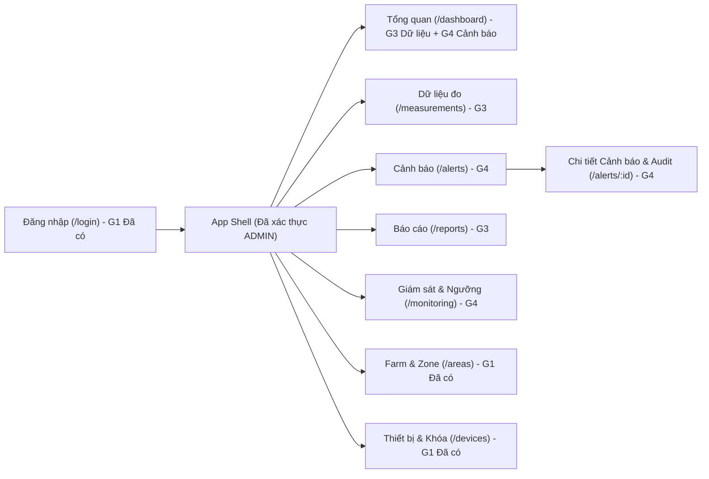

# Thiết kế Giao diện Tổng thể (UI/UX Design Spec) — HQTCSDL

> [!NOTE]
> **Phạm vi tài liệu (Đã đồng bộ G3 — `G3-D01`–`G3-D06`):** Thiết kế khung giao diện tổng thể nhất quán cho toàn bộ hệ thống (G1 + G3 + G4) dựa trên `develop` sau PR #23 (Alembic head `fee0fa015af7`) và các trang Confluence: `FL-01` (v10), `FL-02` (v6), `FL-03` (v11), `FL-04` (v11), `FL-07` (v12), `FL-08` (v9), `FL-09` (v7), `FL-10` (v9), `FL-11` (v8), `FL-12` (v9), `FL-13` (v7), `03.3` (v14), `03.4` (v28), `03.5.1` (v18), `03.6` (v19).
>
> **Nguyên tắc bất biến (Kiến trúc FE vs Contract nghiệp vụ):**
> 1. **Chốt bộ khung FE một lần và tái sử dụng xuyên suốt G3/G4**, nhưng **không để quyết định trình bày giao diện tự làm thay đổi contract nghiệp vụ, DTO, tham số API hay bất biến đã chốt**.
> 2. **Ranh giới theo giai đoạn:** G1 hoàn chỉnh App Shell + `FL-01`/`FL-02`/`FL-03`. G3 kích hoạt thật `FL-07`, `FL-12` (phần dữ liệu & freshness) và `FL-13` (báo cáo & CSV), còn phần **G4** (`FL-04`, `FL-08`–`FL-11`, `FL-12` cảnh báo/đối soát) và vẽ biểu đồ FE (`G3-D05` / `UI-D07`) giữ trạng thái trung thực — **tuyệt đối không dùng dữ liệu giả**.

---

## 1. Sitemap & Phân cấp Điều hướng

### 1.1. Sơ đồ điều hướng tổng thể



### 1.2. Phân nhóm menu & trạng thái sẵn sàng

| Nhóm Sidebar | Mục điều hướng | Route đề xuất | Luồng nghiệp vụ | Giai đoạn | Trạng thái tại G3 |
| --- | --- | --- | --- | --- | --- |
| **Vận hành** | Tổng quan | `/dashboard` | `FL-12` (Dashboard + Thông báo web) | G3 (dữ liệu) + G4 (cảnh báo) | **G3 hoạt động thật** (cảnh báo chờ G4) |
| **Vận hành** | Dữ liệu đo | `/measurements` | `FL-07` (Hiện tại, Lịch sử Known/Unknown, Biểu đồ) | G3 | **Hoạt động thật (API G3; chart FE hoãn sau G3/G4)** |
| **Vận hành** | Cảnh báo | `/alerts` | `FL-11` (Active/History, Audit, Ack) | G4 | Khung chờ (G4) |
| **Vận hành** | Báo cáo | `/reports` | `FL-13` (Thống kê 5 đại lượng & Export CSV) | G3 | **Hoạt động thật (API G3)** |
| **Cấu hình & Quản trị** | Giám sát & Ngưỡng | `/monitoring` | `FL-08` (Ngưỡng/Enable/T), `FL-04` (Quyền tiếp nhận) | G4 | Khung chờ (G4) |
| **Cấu hình & Quản trị** | Farm & Zone | `/areas` | `FL-02` (Vòng đời Farm/Zone) | **G1** | **Hoạt động thật (API G1)** |
| **Cấu hình & Quản trị** | Thiết bị & Khóa | `/devices` | `FL-03` (Node, Gateway, Credentials, 5 Metrics) | **G1** | **Hoạt động thật (API G1)** |
| **Hệ thống (Footer/Topbar)** | Phiên quản trị & Health | Modal / Drawer / Topbar | `FL-01` + `/health/live` | **G1** | **Hoạt động thật (API G1)** |

> [!IMPORTANT]
> **Ranh giới hiển thị khi chưa đăng nhập (`FL-01`):** Khi chưa có phiên `ADMIN` hợp lệ (hoặc sau khi nhận `401 SESSION_INVALID` / hết hạn phiên), App Shell ẩn toàn bộ menu và dữ liệu riêng, chỉ hiển thị màn hình **Đăng nhập** kèm trạng thái kết nối tối thiểu (`/health/live` — ghi rõ chỉ kiểm tra tiến trình API). Trang mặc định sau khi đăng nhập ở Bước 2 là `/areas` và chuyển sang **`/dashboard`** ở G3 (`UI-D01` / `G3-D06`).

---

## 2. App Shell & Responsive Layout

### 2.1. Mục tiêu hiển thị (`NFR-08`)
- Trình duyệt mục tiêu: **Chrome, Edge, Firefox**.
- Độ phân giải desktop chuẩn: **`1366×768`** và **`1920×1080`**, không tràn ngang (`overflow-x`) ở nội dung chính, nhãn tiếng Việt rõ ràng, đơn vị đo và múi giờ **`UTC+07:00`** hiển thị tường minh.
- Thiết bị nhỏ hơn (`< 1024px`): Sidebar thu gọn thành **off-canvas drawer** mở bằng nút menu ở Topbar để đảm bảo thao tác an toàn, nhưng không mở rộng sang ứng dụng mobile riêng ngoài phạm vi MVP.

### 2.2. Bố cục App Shell

```text
+----------------------------------------------------------------------------------+
| [≡] HQTCSDL IoT  |  Farm: [ Chọn Farm (từ FL-02) v ]  | API: Alive | admin | Out |
+------------------+---------------------------------------------------------------+
| SIDEBAR (240px)  | MAIN CONTENT (fluid, max-width 1440px, padding 24px)          |
|                  |                                                               |
| VẬN HÀNH         |  [Page Header: Tiêu đề trang + Mô tả ngắn + Primary Action]   |
|  • Tổng quan     |  [Global Banner: Lỗi mạng / Chưa cập nhật / Phiên cần check]  |
|  • Dữ liệu đo    |                                                               |
|  • Cảnh báo [G4] |  +---------------------------------------------------------+  |
|  • Báo cáo  [G3] |  |  Nội dung trang (KPI / Filter Bar / Table / Split View) |  |
|                  |  |                                                         |  |
| QUẢN TRỊ         |  |                                                         |  |
|  • Giám sát [G4] |  |                                                         |  |
|  • Farm & Zone   |  |                                                         |  |
|  • Thiết bị      |  +---------------------------------------------------------+  |
|                  |                                                               |
| ---------------- |                                                               |
| Backend: Alive   |                                                               |
| Múi giờ: +07:00  |                                                               |
+------------------+---------------------------------------------------------------+
```

### 2.3. Quy tắc từng vùng của App Shell
1. **Sidebar (`240px` desktop, thu gọn `64px` hoặc drawer ở `< 1024px`):**
   - Chia 2 nhóm rõ ràng: **Vận hành** và **Quản trị**.
   - Các mục thuộc G3/G4 chưa triển khai mang nhãn nhỏ (`G3` / `G4`) để Administrator biết rõ lộ trình mà không nhầm tưởng là lỗi.
   - Footer sidebar hiển thị gọn trạng thái `GET /health/live` (giữ nguyên ghi chú: *chỉ kiểm tra tiến trình API, không phải sẵn sàng SQL/cảnh báo*) và nhãn múi giờ mặc định `UTC+07:00`.
2. **Topbar (`56px` cố định trên cùng):**
   - **Trái:** Nút thu gọn sidebar + Breadcrumb vị trí hiện tại.
   - **Giữa (Ngữ cảnh Farm dùng chung cho G3/G4):** Bộ chọn `Farm` tải từ `GET /api/v1/farms` (hỗ trợ lọc gồm cả Farm đã lưu trữ khi xem lịch sử). Theo cập nhật **18/11/2026**, hệ thống **không tự chọn Farm đầu tiên hoặc manifest** — Admin phải chọn Farm tường minh; đổi Farm sẽ reset trang/cursor/view và hủy phản hồi đang bay.
   - **Phải:**
     - Chip tài khoản (`admin.username`) + thời điểm hết hạn phiên (`UTC+07:00`) + trạng thái xác minh phiên (`Đã xác minh` / `Cần kiểm tra phiên`).
     - Nút **Kiểm tra phiên** (`GET /api/v1/auth/session`) và **Đăng xuất** (`POST /api/v1/auth/logout`).
     - *(G4)* Biểu tượng **Thông báo cảnh báo active** (`active_count` từ gói `FARM` của `FL-12`) mở panel thông báo nhanh. Ở Bước 2/G3 **không hiển thị số `0` giả** — ẩn hoặc ghi rõ *"Chờ G4"*.
3. **Vùng nội dung chính:**
   - Luôn có **Page Header** (Tiêu đề + nút hành động chính), **Status/Alert Banner** khi có lỗi toàn trang hoặc phiên chưa xác minh, và **Workspace** (bảng, biểu đồ, hoặc master-detail).

---

## 3. Design Tokens

Kế thừa bảng màu nông nghiệp hiện có trong [style.css](../../frontend/src/style.css) (`#18362b`, `#28573e`, `#f4f7f3`), chuẩn hóa thành hệ thống token rõ ràng, tương phản cao (`WCAG AA`).

### 3.1. Màu sắc (Color Tokens)

| Nhóm | Token CSS | Giá trị Hex | Mục đích sử dụng |
| --- | --- | --- | --- |
| **Brand / Primary** | `--color-primary` | `#28573e` | Nút hành động chính, mục sidebar active |
| | `--color-primary-hover` | `#1e4430` | Hover nút chính |
| | `--color-primary-soft` | `#e6f0ea` | Nền badge active, hàng đang chọn |
| **Surface / Neutral** | `--color-bg` | `#f4f7f3` | Nền tổng thể ứng dụng |
| | `--color-surface` | `#ffffff` | Nền card, bảng, modal, sidebar |
| | `--color-surface-subtle` | `#f8faf8` | Header bảng, vùng phụ |
| | `--color-border` | `#dce6dc` | Viền card, bảng, phân cách |
| | `--color-border-strong` | `#7e9587` | Viền input, select |
| **Text** | `--color-text` | `#18362b` | Chữ chính |
| | `--color-text-muted` | `#53665c` | Nhãn phụ, mô tả, metadata thời gian |
| **Focus** | `--color-focus` | `#b58925` | Viền `focus-visible` (3px, offset 2–3px) |
| **Semantic Status** | `--color-ok-fg` / `--color-ok-bg` | `#1b5e3a` / `#e6f4ec` | `ACTIVE`, `OK`, `FRESH`, `UP_TO_DATE`, `RECOVERED` |
| | `--color-warn-fg` / `--color-warn-bg` | `#8a5300` / `#fef3dc` | `STALE`, `PAUSED`, `PENDING`, `CLOCK_AHEAD`, `Chưa cập nhật` |
| | `--color-err-fg` / `--color-err-bg` | `#a61b1b` / `#fdeaea` | `OPEN` (Alert), `ERROR` (Sensor/Eval), `REVOKED`, lỗi 4xx/5xx |
| | `--color-neutral-fg` / `--color-neutral-bg` | `#475569` / `#eef2f6` | `ARCHIVED`, `UNCONFIGURED`, `NO_DATA`, `NO_EVENT_TIME`, `Đã tắt`, `Đã thay thế (retired)` |

### 3.2. Typography & Spacing
- **Font chữ:**
  - Giao diện: `system-ui, -apple-system, "Segoe UI", Roboto, sans-serif` (hỗ trợ đầy đủ dấu tiếng Việt).
  - Mã định danh / Số đo / Thời gian / API Key: `ui-monospace, SFMono-Regular, Menlo, Consolas, monospace` kết hợp `font-variant-numeric: tabular-nums` để căn thẳng cột trong bảng và KPI.
- **Thang kích thước:**
  - Page Title (`h1`): `1.5rem` (24px), `font-weight: 700`, `line-height: 1.3`.
  - Section Title (`h2`): `1.125rem` (18px), `font-weight: 600`.
  - Body / Table cell: `0.875rem` (14px), `line-height: 1.5`.
  - KPI Value: `1.75rem` (28px), `font-weight: 700`, `tabular-nums`.
  - Caption / Metadata / Eyebrow: `0.75rem` (12px).
- **Spacing & Radius:**
  - Hệ số 4px: `4px`, `8px`, `12px`, `16px`, `24px`, `32px`.
  - Bo góc: Card/Modal `12px`, Input/Button `6px`, Badge/Pill `999px`.

### 3.3. Quy ước Huy hiệu Trạng thái Độc lập (Không được gộp chéo)

> [!CAUTION]
> Theo `FL-08`, `FL-11`, `FL-12`, các chiều trạng thái sau là **độc lập nhau**. Giao diện tuyệt đối không được gộp hoặc suy diễn chéo (ví dụ: không suy `STALE` thành `Offline`, không suy `UP_TO_DATE` thành `Môi trường bình thường`, không gộp `Đã tắt` với `Chưa cấu hình`).

| Chiều trạng thái | Giá trị API | Nhãn hiển thị tiếng Việt | Màu token |
| --- | --- | --- | --- |
| **Vòng đời khu vực (`FL-02`)** | `archived_at = null` / `!= null` | `Đang hoạt động` / `Đã lưu trữ` | `ok` / `neutral` |
| **Quyền tiếp nhận (`FL-03`/`FL-04`)** | `receiving_enabled = true` / `false` | `Đang nhận dữ liệu mới` / `Đã tắt tiếp nhận mới` | `ok` / `neutral` |
| **Chất lượng cảm biến (`FL-07`)** | `read_status = OK` / lỗi (`value = null`) | Hiển thị số thật (kể cả `0`) / `Lỗi cảm biến` | `ok` / `err` |
| **Độ mới mẫu (`FL-12 Freshness`)** | `FRESH` / `STALE` / `CLOCK_AHEAD` / `PROFILE_MISSING` / `NO_DATA` / `NO_EVENT_TIME` | `Mới` / `Quá hạn chu kỳ hiển thị` / `Giờ mẫu vượt giờ Backend` / `Thiếu profile thời gian` / `Chưa có dữ liệu` / `Chưa có giờ đo` | `ok` / `warn` / `warn` / `neutral` / `neutral` / `neutral` |
| **Luồng giám sát (`FL-08`)** | `ACTIVE` / `PAUSED` / `DISABLED` / `UNCONFIGURED` | `Đang giám sát` / `Tạm dừng` / `Đã tắt` / `Chưa cấu hình` | `ok` / `warn` / `neutral` / `neutral` |
| **Đánh giá nền (`EvaluationState`)** | `UP_TO_DATE` / `PENDING` / `ERROR` | `Đã đối soát` / `Đang chờ đối soát` / `Lỗi đối soát` | `ok` / `warn` / `err` |
| **Cảnh báo (`FL-11`)** | `OPEN` / `CLOSED` / `is_current=false` | `Đang mở` / `Đã đóng` / `Đã thay thế (Retired)` | `err` / `ok` / `neutral` |
| **Ghi nhận xử lý (`FL-11`)** | `acknowledged = true` / `false` / `null` | `Đã ghi nhận` / `Chưa ghi nhận` / `Không áp dụng` | `ok` / `warn` / `neutral` |

---

## 4. Wireframe & Thao tác Chi tiết Từng Màn hình

### 4.1. Màn hình Đăng nhập (`/login`) — **G1 (Đã có API thật)**

```text
+-------------------------------------------------------+
|              HQTCSDL · GIÁM SÁT NÔNG TRẠI             |
|                                                       |
|  +-------------------------------------------------+  |
|  |  Đăng nhập quản trị                             |  |
|  |  [Banner trạng thái / lỗi đăng nhập nếu có]     |  |
|  |                                                 |  |
|  |  Tên đăng nhập *                                |  |
|  |  [___________________________________________]  |  |
|  |                                                 |  |
|  |  Mật khẩu *                                     |  |
|  |  [___________________________________________]  |  |
|  |                                                 |  |
|  |  [        Đăng nhập        ]                    |  |
|  |  [    Kiểm tra phiên hiện có    ]               |  |
|  +-------------------------------------------------+  |
|                                                       |
|  Trạng thái API: ● Backend đang phản hồi (/health/live)|
|  (Chỉ kiểm tra tiến trình API; chưa kiểm tra SQL)     |
+-------------------------------------------------------+
```

- **Thao tác người dùng:**
  - Nhập `username` (max 128) và `password` (max 1024), gửi `POST /api/v1/auth/login`. Xóa ngay state `password` ngay khi submit (như [LoginPage.tsx](../../frontend/src/features/auth/LoginPage.tsx)).
  - Nút **Kiểm tra phiên hiện có** gọi `GET /api/v1/auth/session` (hữu ích khi reload hoặc phục hồi kết nối).
  - Nếu đăng xuất trước đó không chắc kết quả (`uncertainLogout`), hiển thị nút **Thử đăng xuất lại** thay vì form đăng nhập.

---

### 4.2. Màn hình Tổng quan / Dashboard (`/dashboard`) — **G3 (Dữ liệu) + G4 (Cảnh báo & Thông báo)**

> [!NOTE]
> Theo `FL-12`: Toàn bộ trang lấy **1 gói snapshot `FARM` duy nhất** từ `GET /api/v1/dashboard` (kèm `farm_id` bắt buộc theo cập nhật 18/11/2026). Chọn thẻ Node chỉ đổi trọng tâm hiển thị số đo ở cột trái, **không làm ẩn danh sách thông báo cảnh báo của các Node khác trong cùng Farm**.

```text
+------------------------------------------------------------------------------+
| TỔNG QUAN FARM: [ Farm A (FARM-01) v ]   Chốt lúc: 15:10:05 +07:00 [Làm mới] |
| [Banner nếu mất mạng/503: "Chưa cập nhật — đang hiển thị lần thành công ..."]|
+------------------------------------------------------------------------------+
| KPI BAR (từ cùng snapshot as_of):                                            |
| +---------------+ +---------------+ +-------------------+ +----------------+ |
| | Số Node       | | Cảnh báo mở   | | Trạng thái đối    | | Dữ liệu mới    | |
| | 2             | | 1 (G4)        | | soát: 1 PENDING   | | 1 FRESH / 1 ST.| |
| +---------------+ +---------------+ +-------------------+ +----------------+ |
+------------------------------------------------------------------------------+
| CỘT TRÁI (65%): THẺ SỐ ĐO THEO NODE        | CỘT PHẢI (35%): THÔNG BÁO (G4)  |
| [Tabs / Cards chọn Node: Node-01 | Node-02]| Cảnh báo đang mở toàn Farm (1)  |
| +----------------------------------------+ | +-----------------------------+ |
| | NODE-01 · Zone 1 · GW-01               | | | [OPEN] Nhiệt độ cao         | |
| | Quyền nhận: Đang bật | Freshness: FRESH| | | Node-01 · Chưa ghi nhận     | |
| | Giám sát ngưỡng: Đang bật (G4)         | | | Phát hiện: 15:05:00 +07:00  | |
| | Giám sát timeout: Đang bật (G4)        | | | [Xem chi tiết FL-11 →]      | |
| | Đối soát: Đã đối soát (G4)             | | +-----------------------------+ |
| | Giờ đo: 15:09:40 +07:00 (tuổi: 25s)    | |                               |
| |                                        | | (Tại giai đoạn G3 trước G4:   |
| | +-------+ +-------+ +-------+          | |  Hiển thị thẻ thông báo rõ:   |
| | | Nhiệt | | Độ ẩm | | Áp suất|         | |  "Cảnh báo & thông báo sẽ     |
| | | 28.5°C| | 72 %RH| | 1012hPa|         | |   kích hoạt ở G4" — KHÔNG     |
| | +-------+ +-------+ +-------+          | |  hiển thị số 0 giả)           |
| | +-----------+ +-----------+            | |                               |
| | | Ánh sáng  | | Độ ẩm đất |            | |                               |
| | | 12400 lux | | Lỗi cảm biến|          | |                               |
| | +-----------+ +-----------+            | |                               |
| | [Xem lịch sử] [Biểu đồ] [Tạo báo cáo]  | |                               |
| +----------------------------------------+ |                               |
+------------------------------------------------------------------------------+
```

- **Quy tắc bắt buộc trên Dashboard (`FL-12` + `G3-D01`/`G3-D02`):**
  - Toàn bộ màn hình dùng `GET /api/v1/dashboard?farm_id=<id>` (`farm_id` bắt buộc; không có `zone_id` ở MVP; Farm/Zone đã lưu trữ trả `200` kèm `scope.farm.archived_at` và `profile.zone.archived_at`).
  - Tại G3 (`capabilities = { monitoring: false, alerts: false }`): các trường G4 (`active_count`, `monitoring`, `evaluation`, `active_alerts`) trả **`null`** — FE hiển thị rõ *"Chờ G4"*, **tuyệt đối không giả `"0"`, `[]` hoặc `UP_TO_DATE`**.
  - **Không hiển thị** `last_new_persisted_at`, `backend_received_at`, credential, SD/queue, hoặc suy luận "Online/Offline" / "Bình thường".
  - Nếu `current.state = NO_DATA` hoặc `NO_EVENT_TIME`, phân biệt rõ 2 trạng thái và có link mở trực tiếp nhóm `UNKNOWN` ở màn hình Dữ liệu đo (`FL-07`).
  - Tự động poll mỗi `5000ms` (timeout `4000ms`), single-flight, dừng khi tab ẩn, gọi ngay khi quay lại tab/reconnect.
  - Các liên kết sang Lịch sử / Biểu đồ / Báo cáo / Cảnh báo chỉ truyền đúng ngữ cảnh (`farm_id`, `node_id`, `episode_id`), không biến bộ lọc lịch sử thành dữ liệu hiện tại hoặc snapshot báo cáo.

---

### 4.3. Màn hình Quản lý Farm & Zone (`/areas`) — **G1 (Đã có API thật)**

Tổ chức lại [AreasPanel.tsx](../../frontend/src/features/areas/AreasPanel.tsx) từ form dọc thành bố cục **Master-Detail 2 cột** trực quan:

```text
+------------------------------------------------------------------------------+
| QUẢN LÝ FARM & ZONE                                        [+ Tạo Farm mới]  |
+------------------------------------------------------------------------------+
| CỘT TRÁI (45%): DANH SÁCH FARM          | CỘT PHẢI (55%): CHI TIẾT & ZONES   |
| [Trạng thái: Đang hoạt động v] [Mã...]  | Farm đang chọn: FARM-01 · Farm A   |
| +-------------------------------------+ | Trạng thái: Đang hoạt động         |
| | ● FARM-01 · Farm A                  | | Mô tả: Khu trồng thử nghiệm        |
| |   Đang hoạt động       [Chọn]       | | [Sửa thông tin] [Lưu trữ Farm]     |
| +-------------------------------------+ | ---------------------------------- |
| | ○ FARM-02 · Farm cũ                 | | DANH SÁCH ZONE    [+ Tạo Zone mới] |
| |   Đã lưu trữ           [Chọn]       | | [Trạng thái: Đang hoạt động v]     |
| +-------------------------------------+ | +--------------------------------+ |
| [Tải thêm (next_cursor)]                | | Z1 · Nhà màng 1   [Sửa][Lưu trữ]|
|                                         | | Z2 · Nhà màng 2   [Sửa][Lưu trữ]|
|                                         | +--------------------------------+ |
|                                         | [Tải thêm Zone (next_cursor)]      |
+------------------------------------------------------------------------------+
```

- **Thao tác người dùng (kết nối 100% API G1 đã có):**
  - Lọc Farm theo `status` (`ACTIVE` | `ARCHIVED` | `ALL`) và tìm kiếm chính xác theo `code`; tải thêm qua `next_cursor`. Trang `Farm & Zone` quản lý danh sách toàn bộ Farm độc lập với bộ chọn Farm dùng chung trên Topbar (`UI-D04`).
  - Mở **Drawer** (`UI-D05`) để Tạo mới (`POST /api/v1/farms`) hoặc Chỉnh sửa tên/mô tả (`PATCH /api/v1/farms/{id}` kèm `expected_row_version`). Không cho sửa `code`.
  - Thao tác **Lưu trữ** (`POST /api/v1/farms/{id}/archive`) / **Khôi phục** (`POST /api/v1/farms/{id}/restore`) mở **Modal xác nhận** (`UI-D05`) nêu rõ quy tắc leaf-first: nếu trả `409 AREA_IN_USE`, thông báo rõ cần tắt quyền/lưu trữ Zone & Gateway con trước (không tự cascade).
  - Tương tự cho danh sách Zone thuộc Farm đang chọn (`GET/POST /api/v1/farms/{id}/zones`, `PATCH/archive/restore /api/v1/zones/{id}`).
  - Khi gặp `409 VERSION_CONFLICT`: giữ nguyên nội dung form trong Drawer, hiển thị thông báo xung đột phiên bản và nút **Tải lại bản mới nhất**.

---

### 4.4. Màn hình Thiết bị & Khóa (`/devices`) — **G1 (Đã có API thật) + Slot G4 (`FL-04`)**

Tổ chức lại [DevicesPanel.tsx](../../frontend/src/features/devices/DevicesPanel.tsx) thành 3 tab rõ ràng trong cùng module Thiết bị:
1. **Tab `Nodes`** (`GET/POST /api/v1/nodes`, `GET/PATCH /api/v1/nodes/{id}`)
2. **Tab `Gateways & API Keys`** (`GET/POST /api/v1/gateways`, `GET/PATCH /api/v1/gateways/{id}`, `GET/POST /credentials`, `POST /revoke`)
3. **Tab `Danh mục đại lượng (Chỉ đọc)`** (`GET /api/v1/metrics` — hiển thị 5 metric chuẩn, đơn vị, miền kỹ thuật `min_value`..`max_value`, `decimal_places`).

```text
+------------------------------------------------------------------------------+
| QUẢN LÝ THIẾT BỊ & KHÓA                      [+ Đăng ký Node / Gateway mới]  |
| Tabs: [ Nodes ]  [ Gateways & API Keys ]  [ Danh mục đại lượng (5) ]         |
+------------------------------------------------------------------------------+
| Filter: [Tìm mã chính xác (device_id / gateway_id)...] [Tìm] [Đặt lại]       |
+------------------------------------------------------------------------------+
| DANH SÁCH (55%)                       | CHI TIẾT THIẾT BỊ (45%)              |
| Mã      | Tên     | Khu vực | Quyền   | NODE-01 · Cảm biến nhà màng 1        |
| NODE-01 | CB NM1  | F1 / Z1 | Bật     | Farm: FARM-01 · Zone: Z1             |
| NODE-02 | CB NM2  | F1 / Z2 | Bật     | Gateway: GW-01 (chỉ đọc)             |
|                                       | Lần lưu mới cuối: 15:09:41 +07:00    |
| [Tải thêm (next_cursor)]              | Quyền tiếp nhận mới: Đang bật        |
|                                       |  ↳ [Bật/Tắt quyền: Chờ G4 FL-04]     |
|                                       |                                      |
|                                       | [Chỉnh sửa Tên / Ghi chú]            |
|                                       |                                      |
|                                       | (Nếu là Gateway → Khối Credentials): |
|                                       | Khóa đang hoạt động: 1 / tối đa 2    |
|                                       | [+ Cấp API Key mới]                  |
|                                       | • #12 · ACTIVE · 18/11 [Thu hồi]     |
|                                       | • #10 · REVOKED · 15/11              |
+------------------------------------------------------------------------------+
```

- **Thao tác bảo mật quan trọng (Gateway Credentials — `FL-03`):**
  - Form đăng ký/chỉnh sửa Node và Gateway mở bằng **Drawer** (`UI-D05`). Khi tạo Gateway mới: chọn `Farm` đang hoạt động từ DB (`GET /api/v1/farms?status=ACTIVE`). Khi tạo Node mới: chọn `Farm` → `Zone` đang hoạt động. Không mở UI chuyển Zone hoặc ghép cặp Node–Gateway.
  - Khi bấm **Cấp API Key mới** (`POST /api/v1/gateways/{id}/credentials`): mở **Modal Show-Once** (`UI-D05`) hiển thị chuỗi `api_key` (`hqgw_v1_...`) cùng nút **Sao chép** và cảnh báo *"Khóa chỉ hiển thị đúng một lần này và không thể xem lại sau khi đóng"*. Đóng modal / đổi tab / logout lập tức xóa `api_key` khỏi React state. Không bao giờ ghi vào `localStorage`/`sessionStorage`/URL.
  - Thao tác **Thu hồi khóa** (`POST .../revoke`) dùng **Modal xác nhận** (`UI-D05`). Hiển thị rõ giới hạn tối đa **2 khóa ACTIVE** cùng lúc (phục vụ rotation không gián đoạn); nếu vượt quá sẽ báo lỗi `409` từ Backend.

---

### 4.5. Màn hình Dữ liệu đo (`/measurements`) — **G3 (`FL-07`)**

```text
+------------------------------------------------------------------------------+
| DỮ LIỆU ĐO                                                                   |
| Phạm vi: [Farm v] [Zone v] [Node * v]   [Đang xem: Khu vực đang hoạt động]   |
+------------------------------------------------------------------------------+
| KHỐI 1: DỮ LIỆU HIỆN TẠI (Fetch riêng, không bị ảnh hưởng bởi bộ lọc lịch sử)|
| Giờ đo: 15:09:40 +07:00 | Chốt lúc: 15:10:05 +07:00                          |
| [Nhiệt độ: 28.5°C] [Độ ẩm: 72%RH] [Áp suất: 1012hPa] [Ánh sáng: 12400lux]    |
| [Độ ẩm đất: Lỗi cảm biến]    (Nếu NO_DATA / NO_EVENT_TIME → link sang UNKNOWN)|
+------------------------------------------------------------------------------+
| KHỐI 2: LỊCH SỬ & BIỂU ĐỒ                                                    |
| Mode: (●) Có giờ đo (Known)   ( ) Chưa xác định giờ đo (Unknown)             |
| Bộ lọc (chỉ khi Known): Từ [____] Đến [____] (UTC+07:00, mặc định 24h) [Lọc] |
| View Tabs: [ Bảng lịch sử ]  [ Biểu đồ chuỗi thời gian ]                     |
| +--------------------------------------------------------------------------+ |
| | (Tab Bảng): Giờ đo (+07) | Boot/Seq | T(°C) | H(%RH) | P(hPa) | L | Soil | |
| |             15:09:40     | 1 / 42   | 28.5  | 72.0   | 1012.0 |...| Lỗi  | |
| |             [Tải thêm trang tiếp theo (cursor + view_token)]             | |
| +--------------------------------------------------------------------------+ |
| | (Tab Biểu đồ — chỉ Known):                                               | |
| |  Chọn đại lượng hiển thị: [✓ T] [✓ H] [ ] P [ ] L [ ] Soil               | |
| |  [Vùng biểu đồ: hiển thị đủ từng điểm, KHÔNG downsample, null là khoảng  | |
| |   đứt — KHÔNG nối thành 0. Nếu còn next_cursor: banner "Chưa tải hết     | |
| |   dữ liệu trong khoảng — bấm Tải thêm để bổ sung điểm"]                  | |
| +--------------------------------------------------------------------------+ |
+------------------------------------------------------------------------------+
```

- **Thao tác & ràng buộc `FL-07` (`G3-D03`, `G3-D05`):**
  - Các endpoint `/api/v1/nodes/{id}/measurements/current`, `/api/v1/nodes/{id}/measurements` và `/api/v1/nodes/{id}/measurements/chart` không nhận `farm_id` (xác định Farm qua FK, cho phép đọc Farm/Zone đã lưu trữ).
  - `GET /api/v1/nodes/{id}/measurements/current` tách biệt khỏi bộ lọc `from/to` của lịch sử.
  - Chọn `time_mode=unknown` sẽ ẩn bộ lọc `from/to` và tab Biểu đồ; hiển thị các bản ghi thiếu giờ đo bằng đúng trường định danh/metadata mà không bịa giờ đo từ giờ nhận.
  - Bảng lịch sử và Biểu đồ dùng chung `view_token` cho cùng `(node_id, from, to)`; đổi Node hoặc `from/to` lập tức vô hiệu `view_token`/`cursor` và hủy request cũ.
  - **G3 vs sau G3/G4 (`G3-D05`):** Backend triển khai và kiểm chứng đầy đủ `GET /api/v1/nodes/{id}/measurements/chart` + shared `view_token` ngay trong G3; tab Biểu đồ ở FE hiển thị thông báo hoãn chọn thư viện & vẽ biểu đồ tới sau khi xong G3 và G4 (không dựng biểu đồ giả).

---

### 4.6. Màn hình Giám sát & Ngưỡng (`/monitoring`) — **G4 (`FL-08` & `FL-04`)**

```text
+------------------------------------------------------------------------------+
| CẤU HÌNH GIÁM SÁT & QUYỀN TIẾP NHẬN                                          |
| Phạm vi: [Farm v] [Zone v] [Node * v]                                        |
+------------------------------------------------------------------------------+
| KHỐI A: QUYỀN TIẾP NHẬN DỮ LIỆU MỚI (FL-04)                                  |
| • Gateway (GW-01): [Bật / Tắt quyền tiếp nhận]  (Cảnh báo ảnh hưởng các Node)|
| • Node (NODE-01):  [Bật / Tắt quyền tiếp nhận]                               |
| Ghi chú: Tắt quyền chỉ chặn Backend lưu bản mới, không gửi lệnh dừng tới IoT.|
+------------------------------------------------------------------------------+
| KHỐI B: GIÁM SÁT TIMEOUT RIÊNG NODE (FL-08)   Trạng thái: Đang giám sát      |
| Thời gian timeout T (phút): [ 15 ]   (Tối thiểu theo profile: 5 phút)        |
| (Nếu timeout_validation.state = MISSING_PROFILE → Cảnh báo thiếu profile kỹ  |
|  thuật, khóa đổi T nhưng vẫn giữ nguyên T hiện có và cho sửa ngưỡng)         |
|                                               [Lưu riêng Timeout T]          |
+------------------------------------------------------------------------------+
| KHỐI C: NGƯỠNG CẢNH BÁO 5 ĐẠI LƯỢNG (FL-08)   Đối soát: Đã đối soát / PENDING|
| Đại lượng   | Bật | Ngưỡng dưới | Ngưỡng trên | Miền hợp lệ | Trạng thái     |
| Nhiệt độ    | [✓] | [ 18.00 ]   | [ 35.00 ]   | -40..85 °C  | Đang giám sát  |
| Độ ẩm KK    | [✓] | [ 40.00 ]   | [ 85.00 ]   | 0..100 %RH  | Đang giám sát  |
| Áp suất     | [ ] | [  —    ]   | [  —    ]   | 300..1100   | Chưa cấu hình  |
| Ánh sáng    | [ ] | [ 100.0 ]   | [ 50000.0 ] | 0..65535    | Đã tắt (giữ cặp)|
| Độ ẩm đất   | [✓] | [ 30.00 ]   | [ 80.00 ]   | 0..100 %    | Tạm dừng       |
|                                     [Lưu nhóm Ngưỡng]  [Lưu tất cả nguyên tử]|
+------------------------------------------------------------------------------+
```

- **Thao tác & ràng buộc `FL-08` / `FL-04`:**
  - Gửi `expected_threshold_config_id` / `expected_timeout_config_id` riêng cho từng nhóm được sửa (`PATCH /api/v1/nodes/{id}/monitoring`), hoặc gửi chung cả 2 để lưu nguyên tử.
  - Không cho xóa cặp ngưỡng hay gửi `null` để xóa `T`; tắt `enabled` phải giữ nguyên cặp `lower/upper` đã lưu.
  - Sau khi lưu thành công, hiển thị rõ nhãn *"Đã lưu cấu hình — trạng thái đối soát cảnh báo: `PENDING`"* (không tự suy là không có cảnh báo).
  - **Miền kỹ thuật 5 đại lượng chuẩn (theo `03.4 §5.1` — hiển thị chỉ đọc từ `GET /api/v1/metrics`):**
    - `temperature`: `°C`, `−40..85`, `2` chữ số thập phân
    - `airHumidity`: `%RH`, `0..100`, `2` chữ số thập phân
    - `pressure`: `hPa`, `300..1100`, `2` chữ số thập phân
    - `light`: `lux`, `0..65535`, `1` chữ số thập phân
    - `soilMoisture`: `% tương đối` (theo seed CSDL M1 `database/seed_foundation.sql`; API báo cáo & token `REPORT_V1` chấp nhận cả `% tương đối` và `%`), `0..100`, `1` chữ số thập phân

---

### 4.7. Màn hình Cảnh báo (`/alerts` & `/alerts/:id`) — **G4 (`FL-11`, `FL-09`, `FL-10`)**

```text
+------------------------------------------------------------------------------+
| QUẢN LÝ CẢNH BÁO                                                             |
| View: (●) Đang mở (Active)   ( ) Lịch sử (History — mặc định 24h)            |
| Filter: [Farm v] [Node v] [Loại: Tất cả|Ngưỡng|Timeout v] [Ghi nhận v]       |
|         [Phục hồi tự nhiên (chỉ Ngưỡng) v]  [Từ ... Đến ... (+07:00)]  [Lọc] |
+------------------------------------------------------------------------------+
| Evaluation Banner: Node-01: UP_TO_DATE | Node-02: PENDING (đang đối soát)    |
+------------------------------------------------------------------------------+
| ID  | Loại / Đại lượng | Node   | Vòng đời | Phục hồi  | Ghi nhận | Phát hiện|
| #42 | Ngưỡng · Nhiệt   | NODE-1 | Đang mở  | Chưa rõ   | Chưa GN  | 15:05 +07|
| #39 | Timeout          | NODE-2 | Đã đóng  | Không AD  | Đã GN    | 11:20 +07|
|                                         [Tải thêm trang tiếp theo (cursor)]  |
+------------------------------------------------------------------------------+

=== CHI TIẾT CẢNH BÁO (/alerts/:id hoặc Drawer rộng) ===
+------------------------------------------------------------------------------+
| Episode #42 · Ngưỡng · Nhiệt độ cao (HIGH) · Revision #2 · Ack version #1    |
| Trạng thái: OPEN (Hiện hành) | Phục hồi tự nhiên: Chưa có bằng chứng         |
| Bằng chứng (Snapshot của Revision #2 — bất biến):                            |
|  • Ngưỡng áp dụng: [18.00 .. 35.00 °C] (Config #7)                           |
|  • Mẫu bắt đầu: #1024 · 36.2 °C lúc 15:04:50 +07:00                          |
|  • (Nếu Timeout: Period S, Baseline L_at_open, T, Witness kết thúc)          |
+------------------------------------------------------------------------------+
| GHI NHẬN XỬ LÝ (POST /api/v1/alerts/{id}/acknowledgements)                   |
| Ghi chú (tùy chọn, tối đa 1000 ký tự, render plain text): [________________] |
| [Xác nhận ghi nhận phiên bản #1]                                             |
| (Nếu is_current=false → Khóa thao tác, ghi rõ "Bản đã bị thay thế (Retired)")|
+------------------------------------------------------------------------------+
| LỊCH SỬ AUDIT (tải từng loại theo yêu cầu):                                  |
| Tabs: [ Revisions ]  [ Acknowledgements ]  [ Replacements (Replay) ]         |
|  • Danh sách phân trang theo cursor; nêu rõ nếu còn dữ liệu chưa tải hết     |
+------------------------------------------------------------------------------+
```

- **Thao tác & ràng buộc `FL-11`:**
  - Chặn tại UI (và xử lý lỗi `400 INPUT_INVALID`) các tổ hợp lọc không hợp lệ: `view=active` + `lifecycle=CLOSED`, hoặc `kind=TIMEOUT` + `recovery_proven=true|false`.
  - Khi `POST /acknowledgements` trả `409 ALERT_VERSION_CONFLICT`: thông báo episode đã biến đổi (ví dụ do Replay), yêu cầu tải lại chi tiết để xem `current_revision_no` / `acknowledgement_version` mới trước khi ghi nhận lại.
  - Ghi chú (`note`) luôn render dưới dạng **plain text**, không render HTML.

---

### 4.8. Màn hình Báo cáo (`/reports`) — **G3 (`FL-13`)**

```text
+------------------------------------------------------------------------------+
| BÁO CÁO THỐNG KÊ DỮ LIỆU ĐO                                                  |
+------------------------------------------------------------------------------+
| BỘ LỌC TẠO BÁO CÁO (Draft State — tách biệt với Kết quả bên dưới)            |
| [Farm * v]  [Zone v]  [Node * v]                                             |
| Từ: [ 18/11/2026 15:00 ]  Đến: [ 19/11/2026 15:00 ] (UTC+07:00, trống = 24h) |
| [ Tạo báo cáo (POST /api/v1/reports/measurements) ]  [ Mặc định 24h ]        |
+------------------------------------------------------------------------------+
| KẾT QUẢ BÁO CÁO (Result Snapshot)     [ Xuất CSV (Khớp snapshot hiện hành) ] |
| [Banner nếu Draft đã sửa: "Bộ lọc đã thay đổi — cần Tạo lại báo cáo để xuất"]|
| Metadata: Node-01 (Zone 1 · Farm A) | Khoảng: 18/11 15:00 → 19/11 15:00 +07  |
|           Chốt lúc: 15:10:02 +07:00 | Tổng bản ghi (N_total): 144            |
|           Hiệu lực xuất CSV đến: 15:25:02 +07:00 (15 phút / hết phiên)       |
| +--------------------------------------------------------------------------+ |
| | Đại lượng     | Đơn vị      | Hợp lệ | Lỗi | Nhỏ nhất | Trung bình | Lớn nhất | |
| | Nhiệt độ      | °C          | 142    | 2   | 21.4     | 26.85      | 33.1     | |
| | Độ ẩm KK      | %RH         | 144    | 0   | 55       | 70.12      | 84.5     | |
| | Áp suất       | hPa         | 144    | 0   | 1008.2   | 1011.45    | 1014.8   | |
| | Ánh sáng      | lux         | 144    | 0   | 0        | 8420.5     | 45200    | |
| | Độ ẩm đất     | % tương đối | 0      | 144 | —        | —          | —        | |
| +--------------------------------------------------------------------------+ |
| Ghi chú: Bản ghi chưa xác định giờ đo (UNKNOWN) không tính vào báo cáo này.  |
|          [Xem nhóm bản ghi UNKNOWN tại Dữ liệu đo (FL-07) →]                 |
+------------------------------------------------------------------------------+
```

- **Thao tác & ràng buộc `FL-13`:**
  - **Tách biệt `draft` và `result`:** Ngay khi Admin sửa Node/`from`/`to`, nút **Xuất CSV** bị `disabled` cho tới khi bấm **Tạo báo cáo** thành công. Kết quả cũ (nếu giữ lại để tham khảo) phải có nhãn rõ *"Kết quả của bộ lọc cũ"* — không gắn nhãn draft mới lên kết quả cũ.
  - Không tự refresh định kỳ như Dashboard. Khi `POST /csv` trả `410 SNAPSHOT_EXPIRED` hoặc `409 REPORT_CONTEXT_CHANGED`, báo lỗi rõ và yêu cầu bấm **Tạo báo cáo** lại, không tự động query ngầm.
  - Khi tải CSV: kiểm tra HTTP `200` + `Content-Type: text/csv` + `auth_generation`/`context_generation` khớp mới kích download `Blob` và `URL.revokeObjectURL`.

---

## 5. Mapping Chức năng → API → Giai đoạn (G1 / G3 / G4)

| Màn hình | Chức năng UI | API Endpoint | Luồng | Giai đoạn | Trạng thái trên `feat/25-g3-query-display-reports` |
| --- | --- | --- | --- | --- | --- |
| **App Shell / Login** | Kiểm tra API sống | `GET /health/live` | Foundation | G0/G1 | **Đã có API thật** |
| **Login / Topbar** | Đăng nhập, kiểm tra phiên, đăng xuất | `POST /api/v1/auth/login`<br>`GET /api/v1/auth/session`<br>`POST /api/v1/auth/logout` | `FL-01` | G1 | **Đã có API thật** |
| **Farm & Zone** | Danh sách, tạo, xem, sửa, archive/restore Farm | `GET/POST /api/v1/farms`<br>`GET/PATCH /api/v1/farms/{id}`<br>`POST /api/v1/farms/{id}/archive`<br>`POST /api/v1/farms/{id}/restore` | `FL-02` | G1 | **Đã có API thật** |
| **Farm & Zone** | Danh sách, tạo, xem, sửa, archive/restore Zone | `GET/POST /api/v1/farms/{id}/zones`<br>`GET/PATCH /api/v1/zones/{id}`<br>`POST /api/v1/zones/{id}/archive`<br>`POST /api/v1/zones/{id}/restore` | `FL-02` | G1 | **Đã có API thật** |
| **Ngữ cảnh** | Context khu vực tương thích | `GET /api/v1/context` | `FL-02` | G1 | **Đã có API thật** |
| **Thiết bị** | Danh sách, đăng ký, xem, sửa Node & Gateway | `GET/POST /api/v1/nodes`<br>`GET/PATCH /api/v1/nodes/{id}`<br>`GET/POST /api/v1/gateways`<br>`GET/PATCH /api/v1/gateways/{id}` | `FL-03` | G1 | **Đã có API thật** |
| **Thiết bị** | Quản lý API Key Gateway (show-once, revoke) | `GET/POST /api/v1/gateways/{id}/credentials`<br>`GET /api/v1/gateways/{id}/credentials/{cid}`<br>`POST /api/v1/gateways/{id}/credentials/{cid}/revoke` | `FL-03` | G1 | **Đã có API thật** |
| **Thiết bị** | Danh mục 5 đại lượng chuẩn (chỉ đọc) | `GET /api/v1/metrics` | `FL-03` | G1 | **Đã có API thật** |
| *(Backend IoT — không phải UI web)* | Gateway gửi batch bản đo & nhận ACK2 | `POST /api/v1/ingestion/measurements` | `FL-06` | G2 | **Đã có API thật** (PR #21) |
| **Dữ liệu đo** | Số đo hiện tại, lịch sử (Known/Unknown), biểu đồ | `GET /api/v1/nodes/{id}/measurements/current`<br>`GET /api/v1/nodes/{id}/measurements`<br>`GET /api/v1/nodes/{id}/measurements/chart` | `FL-07` | **G3** | **Triển khai G3** (BE full + FE current/history; FE chart hoãn sau G3/G4) |
| **Tổng quan** | Dashboard tổng hợp toàn Farm (phần số đo & freshness) | `GET /api/v1/dashboard?farm_id=<id>[&node_id=<id>]` | `FL-12` | **G3** (dữ liệu) | **Triển khai G3** (`capabilities` + `null` G4 fields) |
| **Báo cáo** | Tạo snapshot thống kê 5 đại lượng & xuất CSV | `POST /api/v1/reports/measurements`<br>`POST /api/v1/reports/measurements/csv` | `FL-13` | **G3** | **Triển khai G3** |
| **Giám sát & Thiết bị** | Bật/tắt quyền Backend tiếp nhận mới (Node/Gateway) | `PATCH /api/v1/nodes/{id}/receiving`<br>`PATCH /api/v1/gateways/{id}/receiving` | `FL-04` | **G4** | *Chưa triển khai* |
| **Giám sát** | Xem & cập nhật ngưỡng 5 metric, enable, timeout `T` | `GET /api/v1/nodes/{id}/monitoring`<br>`PATCH /api/v1/nodes/{id}/monitoring` | `FL-08` | **G4** | *Chưa triển khai* |
| *(Worker nền — không API FE)* | Engine đánh giá ngưỡng/replay & timeout Node | Worker nội bộ (không có endpoint web) | `FL-09`, `FL-10` | **G4** | *Chưa triển khai* |
| **Cảnh báo** | Danh sách active/history, chi tiết + audit, ghi nhận xử lý | `GET /api/v1/alerts`<br>`GET /api/v1/alerts/{id}`<br>`POST /api/v1/alerts/{id}/acknowledgements` | `FL-11` | **G4** | *Chưa triển khai* |
| **Tổng quan** | Thông báo cảnh báo active, `active_count`, `evaluation` | `GET /api/v1/dashboard` (bản đầy đủ) | `FL-12` | **G4** (cảnh báo) | *Chưa triển khai* |

---

## 6. Bộ Component Dùng Chung (Reusable Components)

Thiết kế đặt tại `frontend/src/components/` (chưa tạo code ở Bước 1):

| Component | Trách nhiệm | Áp dụng cho |
| --- | --- | --- |
| `AppShell` (`Sidebar`, `Topbar`, `PageHeader`) | Khung ứng dụng, điều hướng, hiển thị phiên & chọn Farm | Toàn bộ ứng dụng |
| `StatusBadge` | Hiển thị badge theo từng chiều trạng thái độc lập (Section 3.3) | Tất cả màn hình |
| `MetricCard` / `KpiCard` | Hiển thị giá trị số (`tabular-nums`), đơn vị, nhãn lỗi/rỗng (không đổi `null` thành `0`) | Tổng quan, Dữ liệu đo |
| `DataTable` + `CursorPager` | Bảng dữ liệu có trạng thái loading/empty/error và nút **Tải thêm** theo `next_cursor` | Farm/Zone, Thiết bị, Dữ liệu đo, Cảnh báo, Audit |
| `FilterBar` | Thanh lọc ngang chuẩn hóa (Select Farm/Zone/Node, Status, DateTime `UTC+07:00`, Reset) | Farm/Zone, Thiết bị, Dữ liệu đo, Cảnh báo, Báo cáo |
| `Drawer` | Panel trượt bên phải dùng cho **form tạo/sửa** (Farm, Zone, Node, Gateway), giữ nguyên dữ liệu nhập khi có `409 VERSION_CONFLICT` | Farm/Zone, Thiết bị |
| `Modal` / `ConfirmDialog` | Hộp thoại trung tâm dùng cho **xác nhận hành động nhạy cảm** (Archive/Restore/Revoke) và **hiển thị API Key Show-Once** | Farm/Zone, Thiết bị, Cảnh báo |
| `StateBanner` / `EmptyState` | Hiển thị lỗi mạng/503, cảnh báo xung đột `409`, trạng thái `Chưa cập nhật`, hoặc màn hình **Khung chờ G3/G4** | Toàn bộ màn hình |
| `FeaturePlaceholder` | Khung trang trung thực cho các mục G3/G4 chưa có Backend (nêu rõ giai đoạn, API dự kiến, không mock dữ liệu) | Tổng quan, Dữ liệu đo, Cảnh báo, Báo cáo, Giám sát (ở Bước 2) |

---

## 7. Quy tắc Trạng thái, Xác thực & Bảo vệ Thông tin

Tuân thủ nghiêm ngặt các quy ước phát triển Frontend ([development.md](../development.md)), `FL-01`, `03.5.1`, `FL-12` và `FL-13`:

1. **Loading / Empty / Error / Pending:**
   - **Loading lần đầu:** Hiển thị skeleton hoặc trạng thái đang tải rõ ràng; không hiển thị số `0` giả.
   - **Empty hợp lệ:** Phân biệt rõ *"Chưa có dữ liệu"* (`NO_DATA`), *"Chưa có giờ đo"* (`NO_EVENT_TIME`), *"Không có bản ghi trong khoảng lọc"* (`EMPTY_RANGE`) và *"Không có kết quả khớp bộ lọc"*.
   - **Error (mạng / `503 STORAGE_UNAVAILABLE`):** Không biến lỗi thành bảng rỗng hay số `0`. Trên Dashboard (`FL-12`) có thể giữ gói thành công gần nhất kèm banner nổi bật *"Chưa cập nhật — lần thành công cuối lúc ..."*.
   - **Pending (`EvaluationState = PENDING`):** Hiển thị nhãn độc lập *"Đang chờ đối soát"*, không khẳng định hệ thống bình thường hoặc không có cảnh báo.
   - **Unknown outcome (mất kết nối sau khi gửi mutation):** Giữ form trong phiên hợp lệ, thông báo chưa xác nhận kết quả và yêu cầu bấm **Đọc lại / Kiểm tra**; không tự retry mutation bằng version mới.
2. **Chống race condition & stale response:**
   - Mọi thao tác đọc dùng `AbortController` + biến đếm tăng đơn điệu (`generation.current` / `auth_generation` / `context_generation`). Đổi Farm, Node, tab hoặc bộ lọc phải hủy/bỏ phản hồi cũ và reset `cursor`/`view_token`.
   - Mọi mutation (`POST`/`PATCH`/`DELETE`) phải đi qua `requestJson`, kiểm `canWrite()` + khóa `operation.current`, gửi đủ `Content-Type: application/json`, `X-HQ-Client: web`, `X-CSRF-Token`.
3. **Xác thực & Bảo vệ thông tin riêng:**
   - Key các panel chứa dữ liệu riêng theo `session.csrf_token` để React tự động xóa sạch state khi đăng xuất, đổi phiên, hoặc nhận `401 SESSION_INVALID`.
   - Ưu tiên `401` cao hơn mọi chính sách giữ cache lỗi mạng: nhận `401` của phiên hiện hành phải lập tức xóa dữ liệu riêng và dừng mọi vòng poll.
   - **Tuyệt đối không lưu** mật khẩu, session token, CSRF token, `snapshot_token`, hay show-once Gateway `api_key` vào `localStorage`, `sessionStorage`, hoặc URL query string.
   - Render mọi chuỗi tự do từ người dùng/hồ sơ (`name`, `description`, `notes`, `ack.note`) bằng **plain text** (React text node), không dùng `dangerouslySetInnerHTML`.

---

## 8. Các Quyết định UI/UX Đã Chốt (Áp dụng từ Bước 2)

Tất cả 7 quyết định dưới đây đã được duyệt và chốt làm chuẩn khung FE xuyên suốt G1 → G3 → G4 (nguyên tắc tối thượng: **không để quyết định trình bày UI tự làm thay đổi contract nghiệp vụ**):

| Mã | Chủ đề | Quyết định đã chốt | Ràng buộc thực thi |
| --- | --- | --- | --- |
| **`UI-D01`** | **Trang mặc định sau đăng nhập** | **`/areas` ở Bước 2 → chuyển sang `/dashboard` ở G3** (`G3-D06`). | Redirect `/` → `/dashboard` khi đã đăng nhập ở G3 (sau khi Dashboard G3 nối API thật); khi chưa đăng nhập luôn về `/login`. |
| **`UI-D02`** | **Cơ chế định tuyến (Routing)** | Dùng **`react-router-dom`** (`BrowserRouter`), không tự viết router. | Cập nhật đồng bộ `frontend/package.json` và `frontend/package-lock.json`; tận dụng SPA fallback đã có sẵn trong [main.py](../../backend/app/main.py) và [vite.config.ts](../../frontend/vite.config.ts) (không sửa Backend). |
| **`UI-D03`** | **Chiến lược CSS / Styling** | **CSS thuần + Design Tokens** (`frontend/src/styles/`). | Không cài Tailwind/UI framework ngoài; giữ `focus-visible` và độ tương phản `WCAG AA`. |
| **`UI-D04`** | **Vị trí bộ chọn `Farm` dùng chung** | **Farm selector trên Topbar** cho các trang Vận hành (`/dashboard`, `/measurements`, `/alerts`, `/reports`, `/monitoring`); trang **Farm & Zone (`/areas`) độc lập**. | Tải Farm từ `GET /api/v1/farms` (theo dõi đủ `next_cursor`), **không tự chọn Farm đầu tiên**, đổi Farm phải hủy request cũ và reset state; không tự gửi tham số trái contract API. |
| **`UI-D05`** | **Form Tạo/Sửa và Hộp thoại Xác nhận / Show-Once** | **Drawer** cho mọi form Tạo/Sửa; **Modal** cho Confirm (Archive/Restore/Revoke) và **API Key Show-Once**. | Drawer giữ nguyên dữ liệu form khi `409 VERSION_CONFLICT` hoặc mất phản hồi; Show-Once Modal xóa `api_key` khỏi memory ngay khi đóng/đổi tab/logout. |
| **`UI-D06`** | **Hiển thị mục chưa hoàn tất trên Sidebar** | **Hiển thị đầy đủ** với `FeaturePlaceholder` trung thực (gắn nhãn `G4` cho phần chưa có API). | Nêu rõ phạm vi & API dự kiến; tuyệt đối không dựng số liệu/biểu đồ/cảnh báo giả. |
| **`UI-D07`** | **Thư viện biểu đồ cho `FL-07`** | **Backend `/measurements/chart` + `view_token` làm ở G3; chọn thư viện & vẽ biểu đồ FE hoãn sau G3 và G4** (`G3-D05`). | Khi vẽ biểu đồ sau G3/G4: không tự downsample, ngắt nét đúng tại điểm `null`, hiển thị cờ đang tải khi chưa hết `next_cursor`. |

---

## 9. Các Quyết định Hợp đồng G3 Đã Chốt (`G3-D01`–`G3-D06`)

> [!NOTE]
> **Contract Gate trước G3 đã được đối chiếu và chốt chính thức:** Không mở migration CSDL mới (giữ Alembic head `fee0fa015af7`, không thêm bảng `Report` hay cột `freshness`). Các quy ước hợp đồng áp dụng thống nhất cho G3 như sau:

| Mã | Chủ đề | Quyết định đã chốt |
| --- | --- | --- |
| **`G3-D01`** | **Phạm vi Dashboard (`FL-12`)** | `GET /api/v1/dashboard?farm_id=<id>[&node_id=<id>]` (`farm_id` bắt buộc; **không dùng `zone_id`** ở MVP để giữ `scope.kind = FARM \| NODE`). Thiếu/sai định dạng tham số hoặc `node_id` khác Farm trả `400 INPUT_INVALID`; thiếu Farm/Node trả `404 NOT_FOUND`. Farm/Zone đã lưu trữ vẫn trả `200` kèm `scope.farm.archived_at` và `profile.zone.archived_at` trong cùng `SNAPSHOT`. |
| **`G3-D02`** | **DTO Dashboard tại G3** | Giữ đủ key của `DashboardView` + thêm `capabilities: { monitoring: false, alerts: false }` tại root; toàn bộ field G4 (`active_count`, `monitoring`, `evaluation`, `active_alerts`) trả **`null`** (tuyệt đối không giả `"0"`, `[]` hay `UP_TO_DATE`). |
| **`G3-D03`** | **Báo cáo (`FL-13`) & Lịch sử Node (`FL-07`)** | `POST /api/v1/reports/measurements` giữ body strict `{ node_id, from?, to? }` (suy Farm/Zone từ FK SQL; `/csv` giữ `{ snapshot_token }`). Bộ API `/api/v1/nodes/{id}/measurements*` không nhận `farm_id`. Cho phép đọc dữ liệu lịch sử của Farm/Zone đã lưu trữ. |
| **`G3-D04`** | **Cấu hình Backend G3** | Tái sử dụng `HQ_CURSOR_SECRET`, `HQ_DATASET_GENERATION`, `HQ_ENV`; bổ sung `HQ_REPORT_SECRET` (`>= 32` UTF-8 bytes, tách biệt CSRF/cursor secret, thiếu khi gọi báo cáo trả `503`), `HQ_REPORT_SNAPSHOT_TTL_SECONDS=900` (`> 0`), và `HQ_NODE_TIME_PROFILES` (JSON map theo `device_id`, mặc định `{}`, thiếu profile trả `PROFILE_MISSING`). |
| **`G3-D05`** | **Biểu đồ `FL-07` (`UI-D07`)** | Backend triển khai và kiểm chứng `GET /api/v1/nodes/{id}/measurements/chart` + shared `view_token` trong G3; lựa chọn thư viện và render biểu đồ phía Frontend hoãn đến sau khi xong G3 và G4 (tab Biểu đồ hiển thị thông báo trung thực, không vẽ giả). |
| **`G3-D06`** | **Nhánh làm việc & route mặc định** | Triển khai trọn gói G3 trên 1 nhánh (`feat/25-g3-query-display-reports`) với các commit gọn theo thành phần và 1 PR vào `develop`; chuyển `DEFAULT_AUTHENTICATED_ROUTE` từ `/areas` sang `/dashboard` khi Dashboard G3 nối API thật. |
